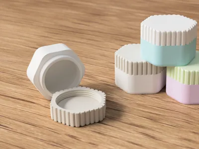
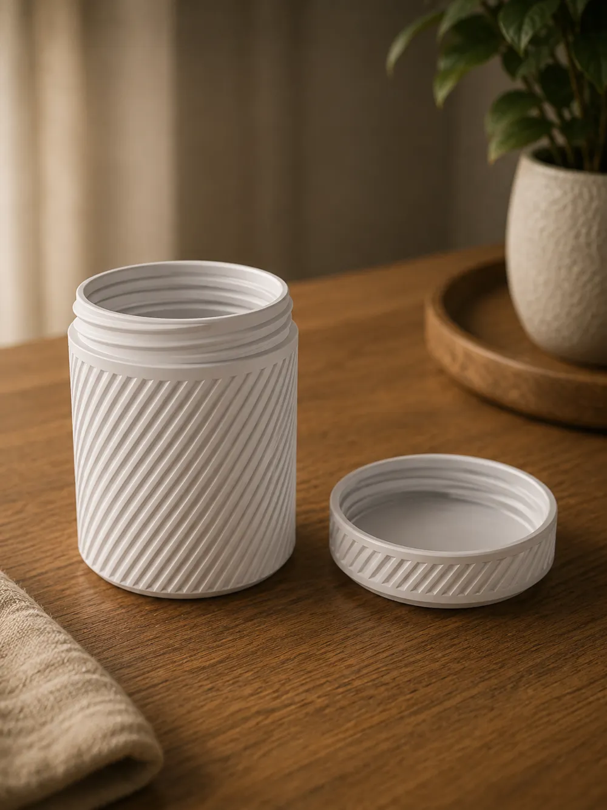
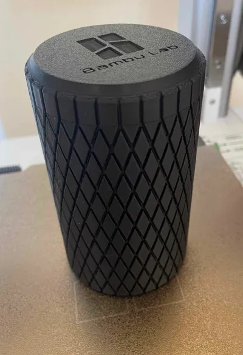
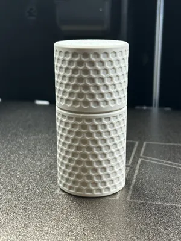
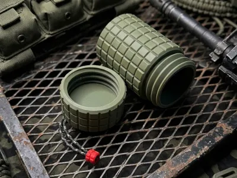
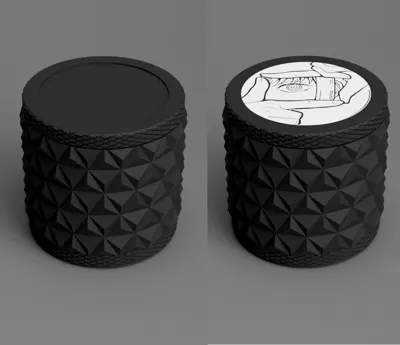
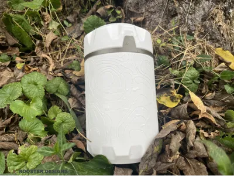
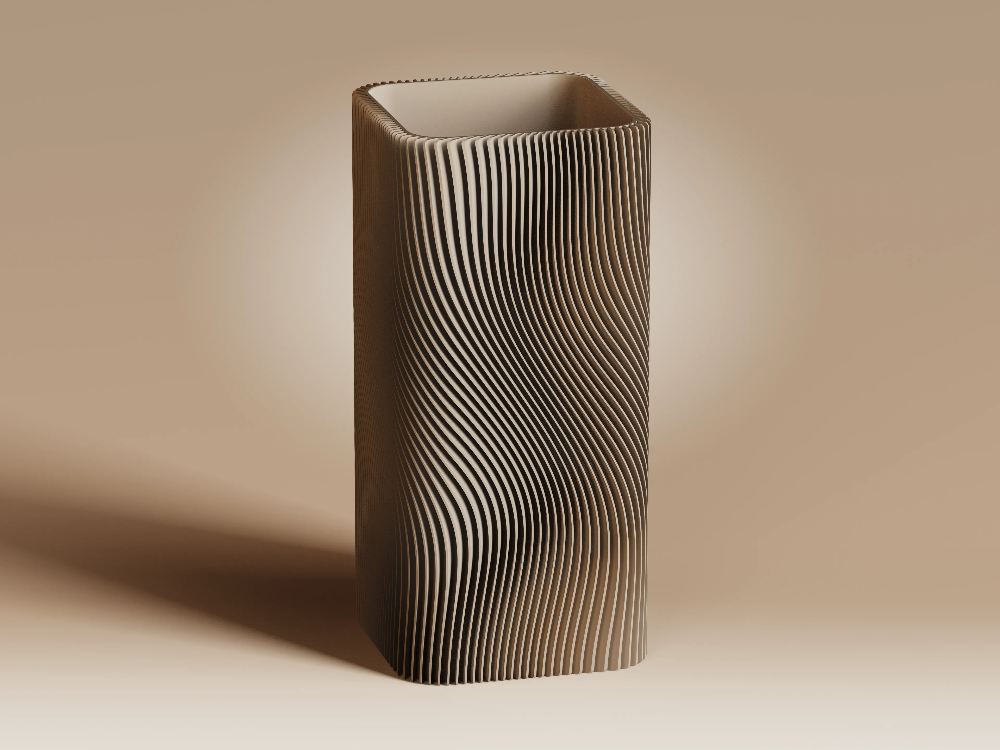
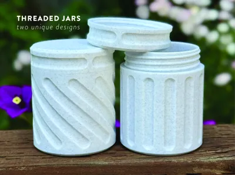
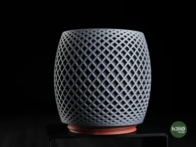

# Container references：重新分組與參數提案

這 33 張圖可整理成 **10 個表面家族，加上獨立的外形、蓋握持、附件與漸變模組**。同一張圖可以使用多個模組；不同尺寸、顏色或同一圖案的粗細不需要新的演算法。以下是逐圖觀察後的設計提案，尚未實作或經使用者選定。

原圖：[圖庫](index.html) · [來源與檔案](README.md)。固定輸入：[sources-v2.json](../../iterations/2026-09-06-pattern-reference-intake/inputs/sources-v2.json)，SHA-256 `3d81399f55b1bd1d34fe6693fc22b51484c433b95009e98407c08b3a79d62f83`；33 張原圖清單 SHA-256 `7102384c86cfa60ba4136c6551c829045aa73a778e976ec297cd174e047128f7`。

照片可說明外觀，不能量出可靠的壁厚、槽深、公差或證明列印強度。本文的可行性是用途與幾何推論；沒有新增 CAD、STEP/STL、切片或實物驗證。圖片中的 waterproof、desiccant、品牌、logo、尺寸與用途文字均保留為來源內容，不轉成效能承諾或實作需求。

## 看圖選家族

點縮圖看原圖；對應連結含候選對應，低解析或有內膽疑問仍以逐圖表的註記為準。P0 的 REF-024 只代表平滑罐身；多角外形與蓋紋另算。

| 家族 | 代表圖 | 對應原圖 |
| --- | --- | --- |
| P0 平滑 |  | [REF-024](images/ref-024.png) |
| P1 規則條紋 |  | [REF-001](images/ref-001.png)、[REF-002](images/ref-002.png)、[REF-003](images/ref-003.png)、[REF-008](images/ref-008.png)、[REF-011](images/ref-011.png)、[REF-014](images/ref-014.png)、[REF-025](images/ref-025.png)、[REF-026](images/ref-026.png)、[REF-027](images/ref-027.png)、[REF-030](images/ref-030.png) |
| P2 菱格 |  | [REF-004](images/ref-004.png)、[REF-005](images/ref-005.png)、[REF-006](images/ref-006.png)、[REF-007](images/ref-007.png)、[REF-016](images/ref-016.png)、[REF-017](images/ref-017.png)、[REF-020](images/ref-020.png)、[REF-021](images/ref-021.png)、[REF-025](images/ref-025.png)、[REF-026](images/ref-026.png) |
| P3 蜂巢／圓窩 |  | [REF-005](images/ref-005.png)、[REF-006](images/ref-006.png)、[REF-018](images/ref-018.png)、[REF-019](images/ref-019.png) |
| P4 方塊 |  | [REF-009](images/ref-009.png) |
| P5 多面尖頂 |  | [REF-005](images/ref-005.png)、[REF-010](images/ref-010.png)、[REF-022](images/ref-022.png)、[REF-023](images/ref-023.png)、[REF-026](images/ref-026.png) |
| P6 等高線 |  | [REF-012](images/ref-012.png)、[REF-013](images/ref-013.png) |
| P7 流動直紋 |  | [REF-031](images/ref-031.png)、[REF-032](images/ref-032.png) |
| P8 圓端短槽 |  | [REF-033](images/ref-033.png) |
| P9 網格／穿孔 |  | [REF-008](images/ref-008.png)、[REF-011](images/ref-011.png)、[REF-015](images/ref-015.png)、[REF-016](images/ref-016.png)、[REF-028](images/ref-028.png)、[REF-029](images/ref-029.png) |

這是幾何重組提案：同圖可跨表面與模組；P9 與 P2 的不確定雙重歸類不表示已確認穿孔。

## 1. 哪些適合一般容器？

**最適合先做的是有完整內壁的淺浮雕。真正穿孔的網格不適合直接當盛粉末、液體或小零件的密閉罐；方形花瓶、蘑菇大蓋、薄片深紋則需要額外設計，並非不能做容器。** 沒有任何照片能證明防水、密封、食物接觸適用性或跌落強度。

| 優先度 | 參考與判斷 | 若要放進日常 screw-cap customizer，需改什麼 |
| --- | --- | --- |
| Core 核心候選 | REF-001–004、007、009–010、017–019、020–021、025、033 的實心表面概念 | 保留完整內腔與既有螺紋，先做淺紋、圓鈍邊。照片裡的吊孔、密封圈、粗蓋等另選模組，不連帶承諾。 |
| Optional 外形／裝飾 | REF-005–006 的漸變；008、011、014、026–027、030 的鼓腹／收底／大蓋；012–013 的等高線；022–024 的稜面或多角外形；031–032 的流線 | 可先把同一表面放在圓柱實心殼上。原比例、異形殼、蓋子與尖薄特徵分開開幾何 gate。 |
| Defer 開孔容器 | REF-015、028 顯示開放網格／穿孔；REF-008 黑款、011 黑款、016、029 疑似開孔，是否有內膽無法由圖確認 | 當筆筒、通風籃或特定顆粒籠有可能合理；普通封閉收納需增加連續內膽，或把孔改成不穿壁的凹紋。加內膽會增加外徑、重量與清潔介面。 |
| Defer 高深寬比細節 | REF-027 的深斜稜、031–032 的薄而密肋片；022–023 的尖稜面；008 黑款／015／029 的細網條 | 先降低突出量、加寬根部、圓鈍尖端，檢查相鄰特徵與螺紋區；之後才做握持、清潔與折損試樣。照片無尺寸，不能判定它們實際脆弱或列印失敗。 |

REF-031/032 的 **Flowing ribs 可成為圓罐外紋**。若連方形內腔也要保留，普通圓形旋轉螺紋不能直接沿方口複製：可選方形外殼＋圓形頸口，或另設計非螺旋蓋。方形旋轉蓋的角部掃掠與間隙需獨立驗證；這不是換一個 pattern 的工作。

## 2. 共用尺寸與隱藏規則

桌面維持 canvas 左、參數右。右側先顯示共用尺寸，再顯示選中圖案的 2–4 個主要控制；切換圖案保留各自設定。圖示要有名稱，slider 同時顯示數值、單位和目前限制；進階設定預設收合。使用者不需要輸入公式或重複描述同一尺寸。

| 區塊 | 日常輸入 | 派生值／內嵌規則 |
| --- | --- | --- |
| 共用容積 S | 內徑 Inside diameter `inside_diameter` mm；內高 Inside height `inside_height` mm；壁厚 Wall `wall_thickness` mm；端厚 Ends `end_thickness` mm | 內高定義為閉合後可用空間，外高由端厚及實際接合幾何推導。外徑／最大外包絡為只讀；不再另給外徑輸入。端厚先共用，上下獨立厚度只在日後明確需要時展開。 |
| 殼與圖案 | 陰刻 Inset／陽刻 Outset 是進階設計選項，照片不替使用者決定 | 現有 crest OD 與全側壁意圖保持不變。新模式先定義壁厚量在谷底或峰頂；禁止切換時偷偷改內腔。凹槽最深處仍須保有經 source gate 確認的剩餘壁厚，不能只檢查平均半徑。 |
| 重複排布 | 主要輸入用間距 Spacing mm，顯示實際間距與重複數 | 沿封閉周長取整數重複，再推導實際間距；不能同時讓間距與數量各自獨立。高度方向維持圖案尺度，邊界裁切／漸退由系統處理，不因改高而拉長花紋。 |
| 保護區 | 接合區 Joint、端部 End 的保護範圍由模型自動管理 | 檢查螺紋根、肩部、排水孔周圍和薄端，不靠名義壁厚推定安全。自動處理不能無聲新增使用者已拒絕的外露光滑 collar；遇衝突顯示原因並要求改可調參數。 |
| 限制 | 不在本文填入照片推測的安全範圍 | min/max、步距與剩餘壁／肋寬下限要由幾何試樣和來源守衛決定。現有壁厚與各 pattern 限制不得被此提案降低；無可行組合時停止生成，保留輸入並說明原因。 |

對圓柱凹紋，可用「名義壁厚 ≥ 最大切入深度＋必要剩餘壁厚」作初步預算；真實 thread-root／肩部與彎曲殼仍需量實際最薄處。對開孔家族另檢查網條寬和連通性，不能套用實心壁規則後宣稱封閉。

## 3. 表面家族參數

下表是**未來 UI 提案**，不表示已支援。主要欄約 2–4 個控制；無單位的選擇用 icons／名稱。高／低凸凹、網格拓撲、尖峰與圓枕是不同幾何變體，必須有各自可辨認的見證，不可只改名稱。成本為相對工程評估，非編譯秒數承諾。

| ID／家族 | 主要參數（中文 / English key；單位） | 可選進階 | 推導／約束；預期成本 |
| --- | --- | --- | --- |
| P0 平滑 Smooth | 無 pattern slider | 不提供假「強度」控制；端面由 B 模組管理 | 無位移；保留精確 baseline。**Simple**。 |
| P1 規則條紋 Regular ribs | 走向 Direction：直／斜／環；間距 Spacing `rib_spacing` mm；深度 Depth `rib_depth` mm；斜紋時傾斜 Lean `rib_lean` °（相對軸向，左右用正反圖示） | 條寬占比 `rib_duty` %、截面 Profile 圓／平槽；body/lid 同向或反向 | 軸向、固定斜率螺旋與水平環各有不同座標規則。斜率、周向重複數決定導程，不能再獨立輸入 turn pitch。條寬由實際間距×占比導出；限制谷／稜寬。**Simple／Bounded**。 |
| P2 菱格 Diamond | 格距 Cell spacing `diamond_spacing` mm；深度 Depth `diamond_depth` mm；表情 Profile：平頂／圓枕／凹心 | 長寬比 `diamond_aspect`、槽寬占比 `groove_duty` %、圓鈍 Softness（無單位預設） | 高頂低槽與低心高交點必須分開驗證；比例推導縱向節距，不再給重複行數。細網格外觀不等於穿孔。**Bounded**。 |
| P3 蜂巢／圓窩 Cell pockets | 孔形 Cell shape：六角／圓；格距 Cell spacing `cell_spacing` mm；凹深 Depth `cell_depth` mm；邊框寬 Web `cell_web` mm | 圓角 `cell_rounding` mm、錯列 Stagger 開／關、凸／凹變體 | 窩寬從格距減邊框推導；不得再獨立輸入窩徑。限定為盲凹窩，穿孔改用 P9。六角與圓輪廓不可混稱同一已完成形狀。**Bounded**。 |
| P4 方塊／裝甲 Grid blocks | 方格間距 Grid spacing `grid_spacing` mm；槽深 Depth `grid_depth` mm；槽寬 Groove width `grid_groove` mm | 方塊長寬比 `grid_aspect`、邊緣圓角 `grid_rounding` mm | 方塊寬＝實際格距−槽寬，邊界不能留下孤立窄塊；平頂方格不同於菱格和尖刺。**Bounded**。 |
| P5 多面尖頂 Faceted studs | 格距 Spacing `facet_spacing` mm；起伏 Height `facet_height` mm；頂部 Crown：尖頂／削平 | 格形 Cell layout 方／菱；削平占比 `facet_truncation` %、圓鈍 `facet_rounding` mm | 三角面須保留清晰面序；尖頂版本不是目前平頂 Diamond。照片尖頂建議先用削平圓鈍變體作日用候選。**Bounded**。 |
| P6 等高線 Contour lines | 線距 Line spacing `contour_spacing` mm；槽深 Depth `contour_depth` mm；流域大小 Feature scale `contour_scale` mm | 線寬 `contour_width` mm；固定種子 Seed 整數；輪廓位置 Offset % | 改尺寸不隨機換圖；凹線閉合、接縫連續，限制局部線間最小距離；不能從照片恢復原作者算法。**Needs prototype**。 |
| P7 流動直紋 Flowing ribs | 肋距 Rib spacing `flow_spacing` mm；起伏 Depth `flow_depth` mm；側向擺幅 Sway `flow_sway` mm；波高 Wave height `flow_wave_height` mm | 肋寬占比 `flow_duty` %；相位 Phase %；單向 S 曲線／週期波模板 | 肋沿高度左右游移，與固定斜率 P1 不同。肋的偏移場須避免互撞及角落擁擠；方形映射先獨立驗證。**Needs prototype**。 |
| P8 圓端短槽 Rounded slots | 槽寬 Width `slot_width` mm；槽長 Length `slot_length` mm；槽距 Spacing `slot_spacing` mm；方向 Orientation：直／左斜／右斜 | 槽深 `slot_depth` mm（初期由保守 preset 管理）；傾角 `slot_angle` °；行距 `slot_row_spacing` mm | 基本圓端半徑由槽寬／2 派生；槽長至少容納兩圓端；斜槽含端帽的最近距離要實測。短槽有終點，不能直接用無限 P1 螺旋假代。**Bounded**。 |
| P9 網格／穿孔 Openwork | 網形 Layout：菱網／長方孔／圓孔；孔距 Opening spacing `open_spacing` mm；網條寬 Web `open_web` mm；結構 Structure：穿孔／加內膽 | 菱網長寬比 `open_aspect`；內膽厚 `liner_thickness` mm；外網徑向厚 `lattice_thickness` mm；端部實心圈由系統管理 | 孔大小由間距和網條導出；無內膽時確實通孔。另驗證節點連通、端圈連接、孔邊與螺紋隔離；內膽不侵蝕共用內徑。**Needs prototype**，不能當一般 relief 切換。 |

P8 初期主面板不超過四項；深度採經未來 gate 確認的 preset，進階才開放。所有家族若參數超出當前可行域，UI 的可用 slider 範圍須即時反映，不能靠事後 compiler error 教使用者。

## 4. 獨立模組：不要把蓋子與外形誤當花紋

| ID／模組 | 主要參數 | 進階／規則與成本 |
| --- | --- | --- |
| B1 圓形輪廓 Body profile | 外形 Shape：直筒／收底／鼓腹；收底 Taper `body_taper` %；鼓腹 Bulge `body_bulge` mm（依外形顯示其一）；底圓角 Base round `base_round` mm | 初期保留圓形內腔與閉合內高，外形增加的外包絡只讀。若要讓內腔也跟隨曲面，另開容積／最薄壁 gate。頸口不隨紋理擠壓。**Bounded**。 |
| B2 多角外殼 Polygon body | 邊數 Sides `body_sides` 整數；外角圓角 Corner `body_corner` mm | 初期圓內腔、圓螺紋，外形以內徑＋壁厚推導最小內切包絡；若改方內腔，以內寬 Inside width 取代內徑，矩形才加內深 Inside depth，不同時保留假直徑。**Needs prototype**。 |
| B3 蓋輪廓 Lid shape | 形狀 Shape：平／圓頂／蘑菇；蓋高 Lid height mm；外伸 Overhang `lid_overhang` mm（有外伸才顯示） | 圓頂可派生曲率，避免再輸入互相衝突的半徑。外伸改外包絡與受力；螺紋蓋不能直接以花瓶照片的罩蓋代替。**Needs prototype**。 |
| G1 蓋握持 Lid grip | 類型 Grip：細直紋／大凹口／圓波；間距 Grip spacing `grip_spacing` mm；深度 Grip depth `grip_depth` mm | 凹口寬占比 %、body/lid 圖案同步；數量由周長導出。握持切口不得切進螺紋。**Bounded**。 |
| A1 吊孔／環 Attachment | 形式 Type：圓孔片／長孔橋；孔寬 Opening `attachment_opening` mm；周邊肉厚 Member `attachment_member` mm；突出高度 Rise `attachment_rise` mm | 片厚 Plate thickness mm、圓角 mm、位置 Angle °、長孔比例；外尺寸從孔＋肉厚導出。檢查螺紋轉動、拉力路徑；照片不能確定整體列印或另件。**Needs prototype**。 |
| A2 頂部把手 Knob | 形狀 Shape：球／錐／圓柱；握頭直徑 Knob diameter mm；高度 Knob height mm | 根頸直徑 Neck mm、P1/P9 外觀；網格把手需獨立根部強度試樣。不得切穿端厚。**Bounded／Needs prototype**。 |
| M1 漸變／覆蓋 Fade | 位置 Coverage：全／下／上／中；覆蓋高度 Coverage height %；過渡長度 Fade length % | 選深度漸變或密度漸變，初期僅深度；深度按位置派生，密度變化另檢查胞格合流。保留組裝接縫的尺度／相位。**Bounded**。 |
| M2 端面圖文 Label（候選） | 內容 Text；大小 Size mm；深度 Relief mm；位置 Placement 圖示 | 陰／陽、字型、patch 等沿既有 roadmap 另開 gate。先用使用者自有文字／圖形；參考圖 logo 不列為照抄需求。**Bounded**。 |

## 5. 每一張圖的對應與實用性（33/33）

「S＋P…」表示共用尺寸加該家族的主要參數，後續「＋」為條件模組。下表每張均有可追溯對應；不確定的圖案不能靠同組其他照片補成確定觀察。

| Reference | 實際可見觀察 | 套用參數家族＋個別差異 | 日用評估／必要調整 |
| --- | --- | --- | --- |
| [REF-001](images/ref-001.png) | 多種高寬圓罐，側身和短蓋都有斜條 | S＋P1 斜紋；蓋紋同步，圖中文字尺寸非量測 | 核心候選；只是尺寸 preset，不需七種算法。 |
| [REF-002](images/ref-002.png) | 開蓋螺紋罐，連續斜槽，口部留平滑區 | S＋P1；螺紋與條紋區分開 | 核心候選；不能直接移入照片口部／螺紋尺寸。 |
| [REF-003](images/ref-003.png) | 黑色斜紋罐，蓋與身斜向視覺相反 | S＋P1；body/lid 反向選項 | 核心候選；反向是變體，需明確是否要求接縫對齊。 |
| [REF-004](images/ref-004.png) | 淺罐，身／蓋細小交錯凸粒 | S＋P2；細間距、圓鈍高頂候選 | 核心候選；細節無法可靠量出，需局部外觀 gate。 |
| [REF-005](images/ref-005.png) | 三種下半部胞格漸變，圖示六角／菱面及反向菱面 | S＋P3／P2／P5 候選＋M1＋B1 | 可選；小圖無法確定每款凹凸拓撲，先比較見證，勿照字標定算法。 |
| [REF-006](images/ref-006.png) | 三罐，低處紋理較明顯、上部較平滑 | S＋M1；P2/P3 候選＋B1 | 可選；遠景不足以定每一胞格形狀，保留待確認。 |
| [REF-007](images/ref-007.png) | 高矮圓罐都有密集交叉小格，平頂 | S＋P2 細菱格；蓋側同步 | 核心候選；金屬視覺／材質不算幾何參數。 |
| [REF-008](images/ref-008.png) | 米色鼓腹斜紋罐；黑色菱網外觀；球形握頭 | S＋P1／P9候選＋B1＋A2 | 斜紋可選；黑款需確認內膽，無內膽不作密閉收納。 |
| [REF-009](images/ref-009.png) | 方格凸塊，粗蓋，旁有繩與紅扣 | S＋P4；蓋同紋；A1僅附件候選 | 核心表面候選；繩的固定處被遮擋，不能據圖指定吊孔結構。 |
| [REF-010](images/ref-010.png) | 細小多面凸紋、大直槽蓋、口部彩色圈 | S＋P5候選＋G1；圈屬另行密封設計 | 核心淺紋候選；精確胞格不清；waterproof 標語不是密封證據。 |
| [REF-011](images/ref-011.png) | 白款斜紋，黑款菱網外觀，蓋有圓形凹握位 | S＋P1／P9候選＋G1＋B1 | 白款可選；黑款需確認通孔／內膽，蓋握位須避開 thread。 |
| [REF-012](images/ref-012.png) | 白色容器淺等高線，大蓋凹口與端部稜面 | S＋P6＋G1＋B2/B3候選 | 可選；輪廓線可先用圓罐，端形／封口另設計。 |
| [REF-013](images/ref-013.png) | 等高線罐另一面，端部凹位 | S＋P6＋G1＋B2/B3候選；不同線場位置 | 同012；兩張不等於兩種 contour 算法。 |
| [REF-014](images/ref-014.png) | 蘑菇輪廓大圓頂，身斜紋；左蓋細亂紋、右蓋斜紋 | S＋P1＋B1＋B3；左蓋粗糙感先視為材質候選 | 可選外形；大罩蓋不等於既有旋蓋，左蓋不據圖新增 noise 算法。 |
| [REF-015](images/ref-015.png) | 可見開孔菱網與弧形外殼，底有獨立色圈 | S＋P9＋B1；底圈連接另查 | 延後普通封閉罐；需連續內膽／改盲凹紋，網條連通和底接合另驗。 |
| [REF-016](images/ref-016.png) | 黑色直筒、密菱網外觀，無可辨蓋結構 | S＋P2 或 P9（待確認） | 先確認是盲凹格還是開網；若開網用收納筒／內膽方案。 |
| [REF-017](images/ref-017.png) | 大菱格平面與深交叉槽，蓋側直槽，頂 logo | S＋P2 平頂＋G1＋M2候選 | 核心候選；深槽縮淺並驗最薄壁；不複製 logo。 |
| [REF-018](images/ref-018.png) | 多尺寸身／蓋均有六角／近圓凹窩，中央接縫可見 | S＋P3＋身蓋同步 | 核心候選；先確認六角與圓窩輪廓，保留盲凹與完整內壁。 |
| [REF-019](images/ref-019.png) | 大六角凹窩，接縫留窄環 | S＋P3 六角；相位／接縫處理 | 核心候選；環外觀不覆寫既有 no-collar 意圖。 |
| [REF-020](images/ref-020.png) | 細菱格長筒，頂端一體外觀圓孔片 | S＋P2＋A1 | 表面核心；吊孔另驗根部、片厚和蓋旋轉。 |
| [REF-021](images/ref-021.png) | 同類菱格與吊孔，左款穿繩 | S＋P2＋A1；顏色與繩為外觀／配件 | 同020；穿繩照片不證明載荷能力。 |
| [REF-022](images/ref-022.png) | 尖稜多面格，細紋端圈，頂面圖像 | S＋P5＋P2端圈候選＋M2 | 可選；日用先削平／鈍化尖角；頂圖不要求複製。 |
| [REF-023](images/ref-023.png) | 同類多面罐開蓋，旁有量勺 | S＋P5＋M2；蓋獨立 | 同022；量勺是獨立物件，不納入表面或自動附件。 |
| [REF-024](images/ref-024.png) | 圓角多角外身、圓內口／螺紋、細直紋圓蓋 | S＋P0＋B2＋G1 | 可選，且示範多角外殼仍可用圓口；不是方形螺紋證據。 |
| [REF-025](images/ref-025.png) | 一款菱格、一款斜紋，圓孔頂蓋；開罐裝棉棒 | S＋P2／P1＋A1 | 表面核心；兩家族共用附件，不需「棉棒圖案」。 |
| [REF-026](images/ref-026.png) | 三小罐、長圓孔頂蓋、不同細白紋、底收圓 | S＋A1長孔＋B1；P1/P2/P5候選 | 可選；圖太小不能確定三個紋理，先確認再選 preset。 |
| [REF-027](images/ref-027.png) | 無蓋、深寬螺旋葉片感、內口也隨輪廓起伏 | S＋P1寬稜候選＋B1 | 延後原樣：先在連續內壁外做較淺斜稜；全殼扭轉與新蓋另開 gate。 |
| [REF-028](images/ref-028.png) | 側身規則長方開孔、端面網孔，旁有線軸 | S＋P9長方孔；端面穿孔另選 | 適合通風／特定顆粒用途候選，非普通密閉罐；需按內容物限定孔徑或加內膽。 |
| [REF-029](images/ref-029.png) | 大菱網側壁，蓋側密圓孔外觀，底面字樣 | S＋P9菱網／圓孔候選＋M2 | 內壁是否封閉不確定；若通孔需內膽；細網／蓋孔需獨立驗證。 |
| [REF-030](images/ref-030.png) | 多比例鼓腹斜肋器皿，平蓋錐把手與一無蓋款 | S＋P1＋B1＋A2＋B3平蓋 | 可選；可先保留圓柱旋蓋做表面，鼓腹／置放蓋獨立設計。 |
| [REF-031](images/ref-031.png) | 四個方形開口高筒，密直肋沿高度流動 | S＋P7＋B2 | 流紋可轉圓罐；方口原樣適合開口收納，旋蓋需圓頸或新封口方案；薄肋先鈍化。 |
| [REF-032](images/ref-032.png) | 方口近景、連續內壁、密而突出 S 形肋片 | S＋P7＋B2；肋寬／深度更需控制 | 同031；能看到內壁但不能量其厚度，深薄肋須先做截面／握持試樣。 |
| [REF-033](images/ref-033.png) | 圓螺紋罐，身為直／斜圓端盲槽，蓋側短橫槽 | S＋P8＋G1的P8短槽變體 | 很適合核心外觀候選；槽端停止及圓帽要保留，別用連續 Spiral 代替。 |

## 6. 與既有 roadmap 的關係及下一個小 gate

[FEATURE_BACKLOG.md](../../FEATURE_BACKLOG.md) 保留既有順序與歷史，這次沒有改寫或宣布完成。現有五種 Smooth／Diamond／Ribs／Rings／Spiral 的來源與限制仍成立；P0、P1 和 P2 有交集，並不表示照片變體已實作。Rings 沒有明確主圖代表，但仍保留已交付家族。Knit stitch 沒有在這 33 張中可靠辨認出；未因缺照片而刪除。Flowing／Wave flutes 的舊 distinctness gap 也不因 P7 命名而關閉。

建議產品優先：**Core** 保留實心圓柱，逐一增加／比較 P8 圓端槽、P3 蜂巢、P4 方塊，以及 P2 的明確凹心／圓枕變體；**Optional** 再做 M1 漸變、G1 握持與 P7 流紋的圓柱版；**Defer** 才進開網、方內腔、整殼扭轉、大罩蓋、細薄肋和載荷附件。這是候選排序，不覆蓋使用者原先的一次一項審閱順序，也不把目前 recessed-diamond appearance gate 視為已通過。

下一步只需選一個外觀做小型平展圖＋局部截面：看清「高處／低處／是否穿壁」及粗細與深度的兩個關係，說明固定內壁與可調項，再請使用者 PASS／調整。之後才凍結實際數值域、真實 source 和 CAD／export／physical 分離的驗證計畫。可編譯、好看、可裝東西和實物耐用是不同的證據。
