# Container pattern references — 2026-09-06

This frozen archive contains all 33 images supplied by the user in their original batch order. REF-031 through REF-033 append batch 4 without renumbering the original 30. Each PNG is copied byte-for-byte; none was deleted, deduplicated, renamed semantically, re-encoded, cropped, or otherwise transformed.

The images are reference evidence only. Any text, dimensions, branding, product claims, or print claims visible inside an image remain unverified reference content. Neutral IDs avoid imposing a semantic classification on the archive.

- Browse the [responsive gallery](index.html).
- Read the separately authored [pattern grouping, feasibility, and parameter proposal](PATTERN_PARAMETERS.md).
- Machine-readable provenance is in [catalog.json](catalog.json).
- Archive integrity hashes are in [SHA256SUMS](SHA256SUMS).
- Final frozen intake inputs are [sources-v2.json](../../iterations/2026-09-06-pattern-reference-intake/inputs/sources-v2.json) and [source-images-v2.sha256](../../iterations/2026-09-06-pattern-reference-intake/inputs/source-images-v2.sha256).
- The original 30-image [sources.json](../../iterations/2026-09-06-pattern-reference-intake/inputs/sources.json) and [source-images.sha256](../../iterations/2026-09-06-pattern-reference-intake/inputs/source-images.sha256) remain preserved as historical intake manifests.

| ID | Original thumbnail | Batch / position | Dimensions (px) | Bytes | SHA-256 |
|---|---|---:|---:|---:|---|
| REF-001 | [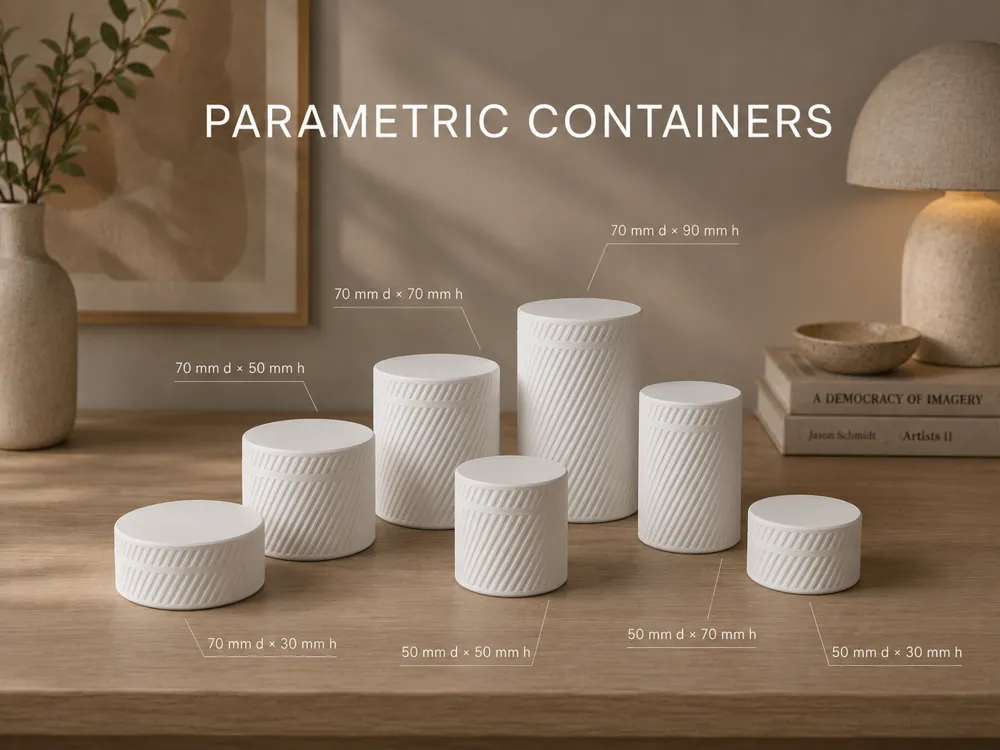](images/ref-001.png) | 1 / 1 | 1000 × 750 | 643,406 | `d83b2b06bc7609a71c996504b3537f6b55586382f8ae83ecebc661ef09d1d892` |
| REF-002 |  | 1 / 2 | 1000 × 1333 | 1,131,760 | `e2024c5cd82c844db3a7fb3b85a7f3f93fb95e320b9394a3278435ea473dfa68` |
| REF-003 | [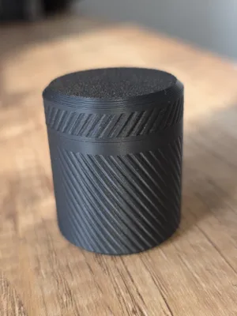](images/ref-003.png) | 1 / 3 | 300 × 400 | 146,281 | `e1e7f67594af337e2b8ccc7da46c6c9484a728b5e883c4b8bb20e35198508507` |
| REF-004 | [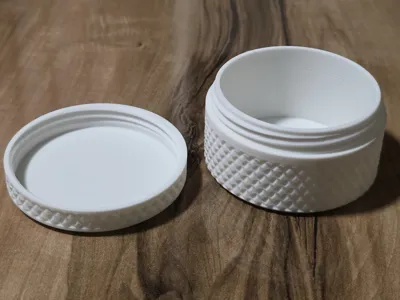](images/ref-004.png) | 1 / 4 | 400 × 300 | 147,017 | `e6fc625c6603cbc5b2979fb768eabb8a91cb935899406d1ad831500b32597287` |
| REF-005 | [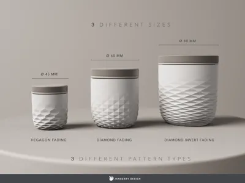](images/ref-005.png) | 1 / 5 | 400 × 300 | 61,514 | `624cded749426914eadee7d3798100905be6c5d13bf9c62b21119dd998f1640b` |
| REF-006 | [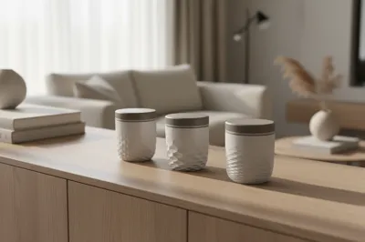](images/ref-006.png) | 1 / 6 | 400 × 266 | 93,375 | `cd90fc9874d253cc65319a7de6b6ec43002faadc6c41ca9ca38805e9a448cf54` |
| REF-007 | [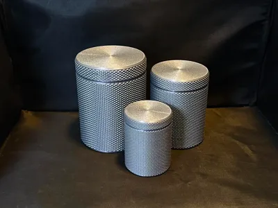](images/ref-007.png) | 1 / 7 | 400 × 300 | 148,988 | `4609295e0176efb52d40c8020239cfa8f4f58581fea673746cfdce826e4759c5` |
| REF-008 | [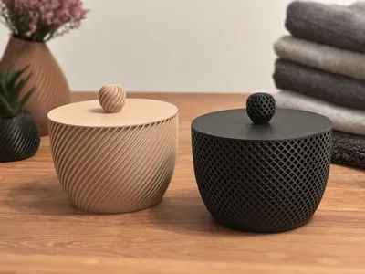](images/ref-008.png) | 1 / 8 | 400 × 300 | 148,174 | `24719fd6e638b815fef390fb946c68e1eecbee7404582ca079066643ff839afc` |
| REF-009 |  | 1 / 9 | 400 × 300 | 212,616 | `043ea622f7106222509eb8724f76abe10c9084adb38830a573956ec629a5cea4` |
| REF-010 |  | 1 / 10 | 400 × 318 | 136,282 | `0a8da1085aa6c99e42d9671d20e503a53a4e3167c3d2117733c8860b28e2e71b` |
| REF-011 | [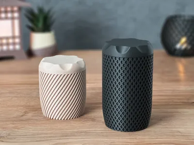](images/ref-011.png) | 2 / 1 | 400 × 300 | 176,641 | `3ec21b0d074821fc1fdbd4b87abd1710b8ff861ef5331936a6ddcd580a74c21f` |
| REF-012 | [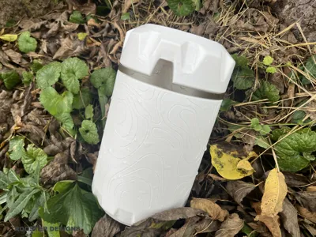](images/ref-012.png) | 2 / 2 | 400 × 300 | 230,481 | `4e902c4863a44e10c340ee10f643c5f0842f508def3103f417173b5646cba263` |
| REF-013 |  | 2 / 3 | 400 × 302 | 266,869 | `027dd8c4e03af07b05ad05c9c318f61eb84f428968ce7fe9a2f99874e9f59710` |
| REF-014 | [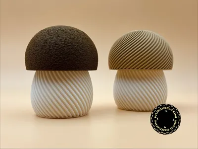](images/ref-014.png) | 2 / 4 | 400 × 300 | 120,654 | `49acb212d21046dfe5c6523f0c2b6ee4ea8801b29cf2a3bf15dd9f7933ff16f7` |
| REF-015 |  | 2 / 5 | 400 × 300 | 94,950 | `4f8044b7e37690e6ba8c8e32db5146ea8a57095ad91ccf807e6bdec0a778a68a` |
| REF-016 | [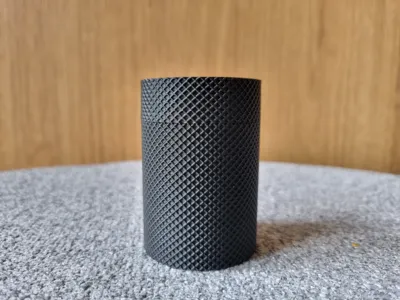](images/ref-016.png) | 2 / 6 | 400 × 300 | 154,928 | `30d92830e219e2f43c837b0154ae1d94dfda40aa363aec35303ff6b9191e5832` |
| REF-017 |  | 2 / 7 | 400 × 585 | 270,658 | `dbc3f1a2f3e499459ad2bed8bf530923d0bd40a470463a0e931652682108b8d4` |
| REF-018 | [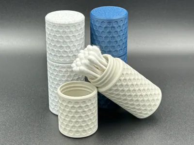](images/ref-018.png) | 2 / 8 | 400 × 300 | 159,082 | `71a4dbcb872a2b53c109f8e8401f06ac320f4870048d085266f472ba43f1bba4` |
| REF-019 |  | 2 / 9 | 300 × 400 | 153,766 | `57fef8f6b13456ec14747fdee7eebe049bc99e34ae5eced1570e6a4eb15f2401` |
| REF-020 | [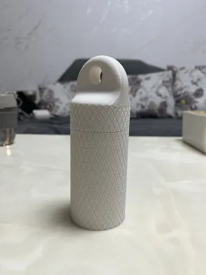](images/ref-020.png) | 2 / 10 | 300 × 400 | 103,014 | `c35a74fed891fc0e6298f5bb1b521c84d2fe9de6854b38d02f1627b798bbe40c` |
| REF-021 | [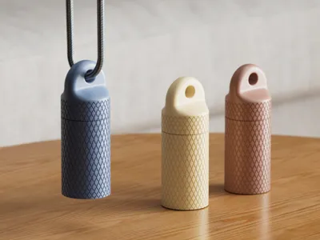](images/ref-021.png) | 2 / 11 | 400 × 300 | 123,199 | `eace9e1671d7a1a470cd0de88e2d35eda0d4f2de8e33bdf02ae94ff8820e47d2` |
| REF-022 |  | 3 / 1 | 400 × 345 | 68,867 | `3e3fe02f285c16a129f2daa97d74e567beeb5046958aa914d93aa85d4a81c0f3` |
| REF-023 | [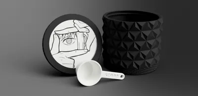](images/ref-023.png) | 3 / 2 | 400 × 194 | 43,913 | `99f324a7383f8229116c3f2ccee313f6c133115ba7207f5b7d0b18f55c01a0ef` |
| REF-024 |  | 3 / 3 | 400 × 300 | 151,566 | `82ddf2b9646b70331189fb428ca27d3f06ff2e1cdec23b64ed3d2a54d133b78b` |
| REF-025 | [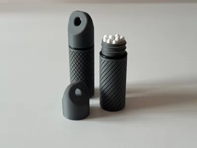](images/ref-025.png) | 3 / 4 | 400 × 300 | 61,685 | `68440e1f9ade22d02327edad03b98dfc971e648e1e847c7efcdbe43dfe64b954` |
| REF-026 | [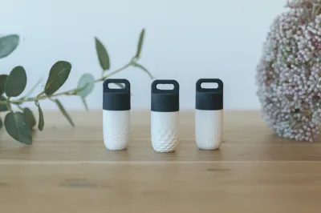](images/ref-026.png) | 3 / 5 | 400 × 266 | 95,874 | `cc542dfce18a367eb1c38fca80e5576753a65ad8d6e7c4e5f2c035b634d8515e` |
| REF-027 |  | 3 / 6 | 400 × 533 | 277,446 | `3a0a2604c90b32041d1598b3d2c17476d78e67cbbb9ed9787af004008fea7094` |
| REF-028 | [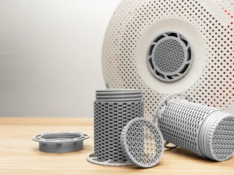](images/ref-028.png) | 3 / 7 | 400 × 300 | 158,032 | `03061b81dd4d6f70e871c92b2c6e0da94660ed70cabdb90bea06f46687eebaef` |
| REF-029 | [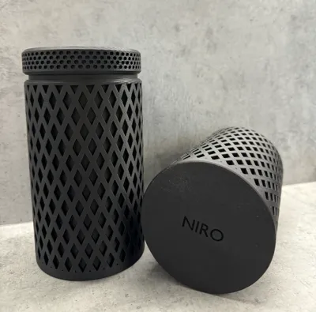](images/ref-029.png) | 3 / 8 | 400 × 395 | 184,332 | `3da7f74c2f43c544affab90465051091ec85d0efa86b6474716ea4a73914a6fa` |
| REF-030 | [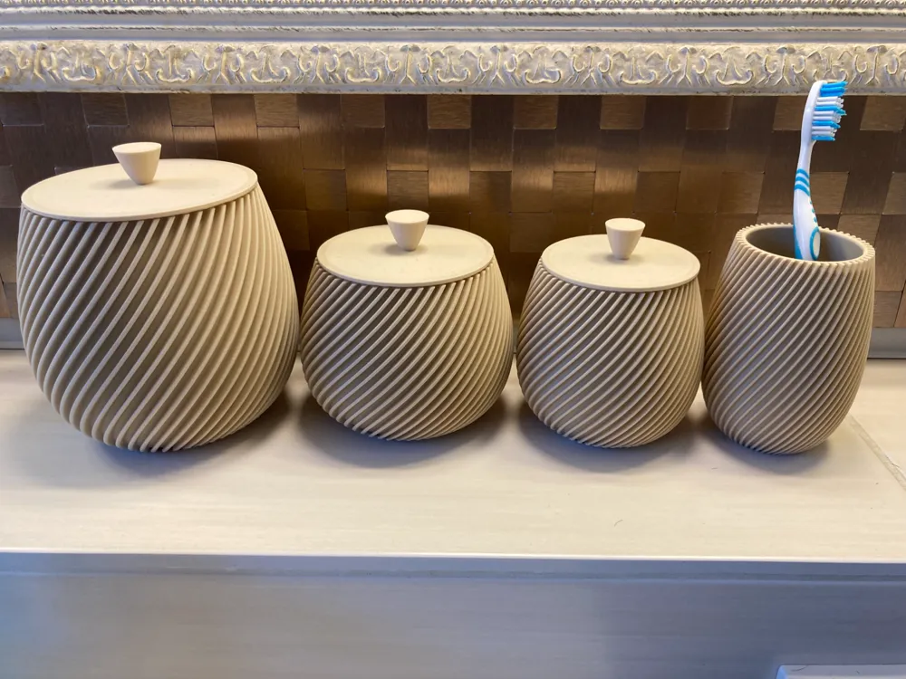](images/ref-030.png) | 3 / 9 | 1000 × 750 | 888,934 | `5b54fb75f7086982dc636e80877edbe82416dac58e678a6db7db409ae849d4a6` |
| REF-031 | [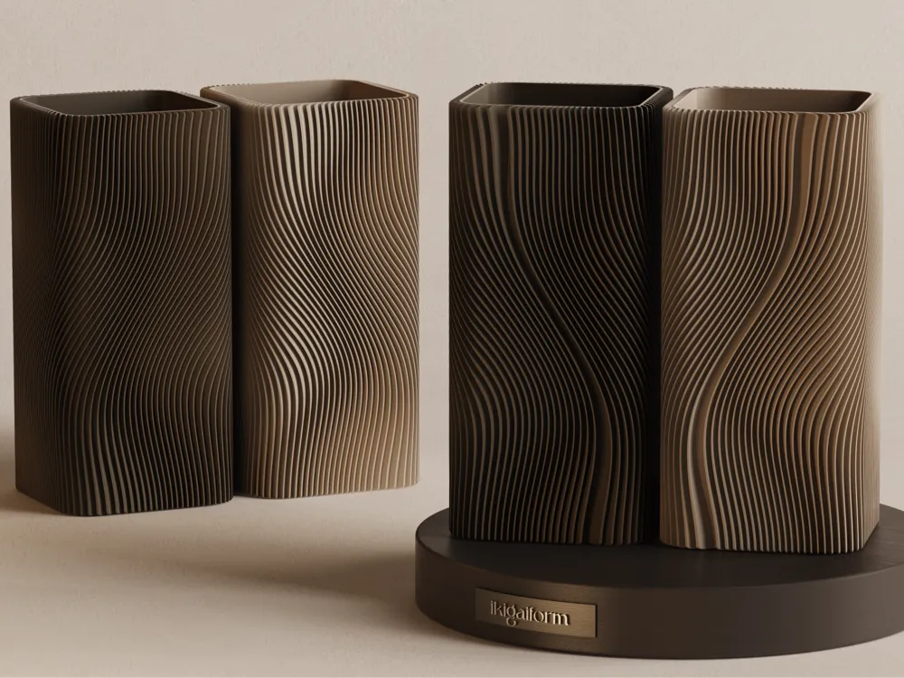](images/ref-031.png) | 4 / 1 | 1000 × 750 | 919,038 | `a97cad539e2cc1c29996f4553aea278d4959bcba1034ca2d393c85fbcb97b6a5` |
| REF-032 |  | 4 / 2 | 3840 × 2880 | 4,482,000 | `e42841173279352cf6385251289f686a2af15bcc84d7d2162c7e7da146c68434` |
| REF-033 |  | 4 / 3 | 400 × 299 | 207,184 | `33e92b063b50b4412c7e45cfb236d0c09e8182921b8ff98ca043c5b5bd6d44b1` |
